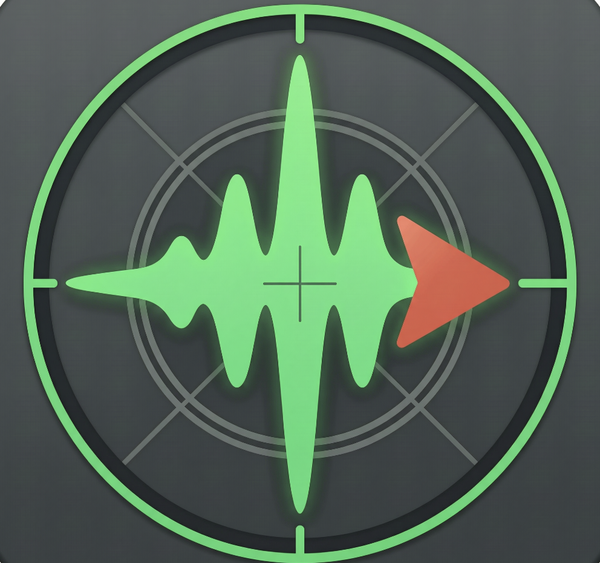

# NoiseRadar

An iOS SwiftUI app that finds the direction of the loudest sound by combining
microphone amplitude with the device's compass heading while the user turns
around 360°.

## Features
- Live sound level visualization (raw + smoothed)
- Offline on-device sound type classification using Apple's built-in SoundAnalysis classifier
- Broad sound categories such as human voice, vehicles, mechanical sounds, animals, alarms, music, nature, household, and impact sounds
- Direction results by sound type, so users can separate voice, animal, vehicle, mechanical, alarm, and other sound directions
- Scan 360 mode for direction finding and Listen mode for foreground sound monitoring
- Local in-app event history for recent sound categories, headings, confidence, and dB estimates
- Configurable foreground threshold alerts by sound type, dB level, confidence, and alert style
- Shareable local session reports with text summary and CSV event log content
- Manual dB calibration offset with reset guidance
- First-run onboarding and readiness checklist for microphone, compass, rotation speed, and noise floor
- Radar-style direction display with compass labels (N/E/S/W)
- Polar "sound blob" visualization of sampled audio
- Top 3 loudest headings display
- Start/Stop scan flow with calibration step
- Scan progress indicator for the 360° sweep
- Scan quality indicator (too fast, too quiet, too noisy)
- Adaptive noise floor + EMA smoothing + high-pass filtering
- Gyro-based fast-rotation rejection
- Haptic feedback on start/stop/result
- Help screen with quick usage steps and tips
- Custom launch image on app start

## Requirements
- macOS with Xcode 15+ (or newer)
- iPhone with microphone + compass (magnetometer)
- iOS 15.0+

The app is configured as an iPhone-only app. It does not add iPad, Apple Watch,
Mac Catalyst, or Vision Pro companion targets.

## Project Layout
- `NoiseRadar/NoiseRadar.xcodeproj` – Xcode project
- `NoiseRadar/NoiseRadar/` – App source code
  - `AudioDirectionManager.swift` – microphone + compass + offline sound classification logic
  - `SoundRadarView.swift` – UI
  - `Info.plist` – permissions

## Permissions
The app requests:
- Microphone access to read sound levels
- Location access (When In Use) to read compass heading

## Quick Start
1. Open `NoiseRadar/NoiseRadar.xcodeproj` in Xcode.
2. Set your Development Team in Signing.
3. Run on a physical iPhone.
4. Tap **Start Scan**, rotate 360°, tap **Stop & Analyze**.

The app does not need internet access for scanning or sound type labels. Sound
levels, compass heading, and sound classification are processed locally on the
iPhone.

For full deployment steps, see `how_to_deploy.md`.

## Demo
YouTube Shorts demo: https://youtube.com/shorts/kxWObeB3aho?feature=share

## Project Credits
Main website: https://www.vozhyk.com/
